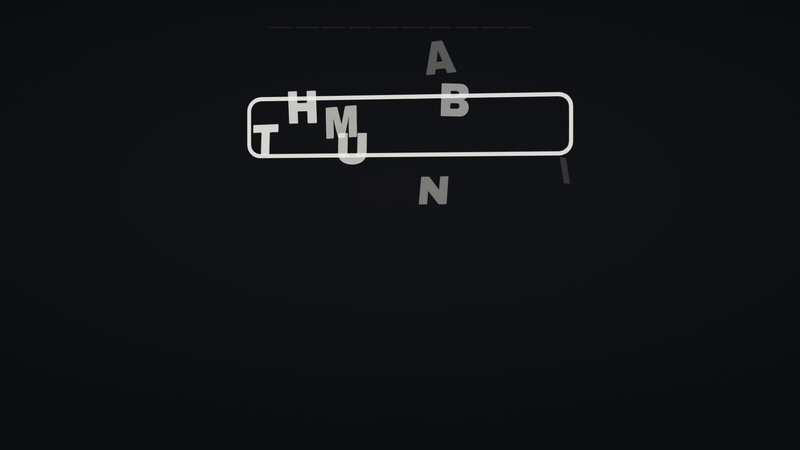

# Thumbnail Studio

<p align="center">
  <a href="LICENSE"></a>
  
  
  
  
</p>

A local, private studio that turns one video brief into **7 ready-to-choose
YouTube thumbnails**, on brand, every time, then scores your title against the
one that wins. Start from a title, or start from a concept and write the title
afterwards, which is how most creators actually work.

It was built as a self-directed system and tuned on one real channel:
[The Next New Thing](https://www.youtube.com/@TheNextNewThingAI), which was the
test case rather than a client. That channel is the worked example, not the
product. Everything specific to it is a setting,
a photo folder or a document you rewrite, so pointing the studio at your own
channel takes about an hour (`docs/ADAPTING.md`).

The workspace runs locally without a database or required API key. Image
generation uses a provider you choose: the **Codex app**, the included
**Playwright runner** through your signed-in ChatGPT session, a **browser
agent**, the **OpenAI API**, or manual copy-paste. Provider access, supported
formats, usage limits and costs depend on your account. No password is stored
by the runner. Each route uses the generated instruction pack; see
[SETUP.md](SETUP.md) for the available setup paths.


<p align="center">
  <picture><source media="(prefers-reduced-motion: reduce)" srcset="docs/readme-hero-poster.png"></picture>
</p>

[Static preview](docs/readme-hero-poster.png) · [Requirements](#requirements) · [Quick start](#quick-start) · [Documentation](#documentation) · [Support](#support)

## Requirements

Node.js 18 or newer is the package minimum; use a currently supported LTS release for a new installation. Windows, macOS and Linux launchers are included. Image generation also needs access to your chosen provider. See [SETUP.md](SETUP.md).

<a id="quickstart"></a>

## Quick start

- **Windows**: double-click `START.bat`
- **Mac / Linux**: `chmod +x START.command app/start.sh` once, then
  double-click `START.command` (or run `bash app/start.sh`)

The studio opens at http://localhost:4626. It starts empty, which is the
correct empty: no projects, no photos, no keys.

Two things make it yours, both in the first five minutes:

1. Put 3 to 5 photos of whoever appears in your thumbnails into
   `brand/host-photos/`. At least one sharp, frontal headshot. They are attached
   to every generation, so they decide how well the likeness holds.
2. Open **Settings** and fill in host name, show name and your YouTube channel
   URL. Pick your main host photo from the dropdown while you are there.

Then read the **How it works** page in the app, or `docs/TUTORIAL.md`.

## Documentation

[Setup and providers](SETUP.md) · [Tutorial](docs/TUTORIAL.md) · [Adapt to your brand](docs/ADAPTING.md) · [Runbook](docs/RUNBOOK.md)

## Support

Use [GitHub issues](https://github.com/jqaisystems/thumbnail-studio/issues/new/choose) with your operating system, Node version and generation route. Share a minimal redacted reproduction. Keep browser profiles, photos without permission, keys and private project packs out of issue attachments.

## What it does

- **Brand engine**: 7 layout archetypes × 7 rotating colorways, so every video
  gets genuinely different options that still look like one channel.
- **Suggestions**: researched guest and topic ideas, refreshed weekly; one
  click prefills a project.
- **Auto references**: the host's photos attach automatically; guest photos
  are found online by name (keyless image search); backgrounds and logos have
  their own slots; local background removal included.
- **Test & choose**: the Arena (pairwise duels), Reality Check (your
  candidates inside your REAL channel feed, or hidden among decoys, with
  blur/grayscale/size stress tests), and the Tiny-size Lab (measured
  legibility at 168px).
- **Title, scored against the winner**: candidate titles are measured against
  the winning thumbnail as you type, aiming for roughly half their words shared,
  with the verdict in words and not only a number. Tick the directions you like
  and an agent writes more in that register.
- **Final round**: when the title moves on and the pair drifts apart, re-cut the
  winner with new words, or re-render it in a new colorway, instead of starting
  the packaging over.
- **Learning loop**: winner analytics bias future packs toward what wins.
- **Export**: YouTube-ready 1280×720 JPG under 2MB in one click.
- **Clean by default**: images made through ChatGPT arrive with a C2PA
  "Content Credentials" block of about 25KB. The studio strips it from
  generated images without re-encoding them, and sweeps again before building
  a delivery ZIP. Turn it off in Settings if you want the label kept.
- **Roadmap**: monthly improvement proposals you accept or decline.

## Folder map

```
├── START.bat / START.command   launchers (Windows / Mac)
├── app/                        server + UI (Node, Express, vanilla JS)
├── brand/                      host photos + style references
├── projects/                   one folder per video (prompts, refs, results)
├── data/                       settings, suggestions, roadmap (JSON on disk)
├── docs/                       TUTORIAL, RUNBOOK, BLUEPRINT, ADAPTING
└── scripts/                    scheduled refresh jobs (Windows)
```

## Make it yours

Everything brand-specific is data, not code: host name, show name, channel
URL and generation provider live in **Settings**; photos live in `brand/`;
the visual DNA lives in `docs/BLUEPRINT.md` + `app/lib/blueprint.js`.
Full guide: `docs/ADAPTING.md`.

## Recommended setup

The **Codex app** is the recommended starting point for this system. Give it
a project's `pack/CODEX_INSTRUCTIONS.md` and choose image-generation options
supported by your account. Inspect the saved images before importing or exporting them.
Everything else (Playwright script, browser agent, OpenAI API, manual) is a
fallback that reads the same instruction pack.

## Delivering a video

Press **Download everything (ZIP)** on a project. You get one archive:
`1-youtube/` (the 1280x720 upload), `2-social/` (X, LinkedIn, portrait),
`3-texts/` (posts and alt texts), `4-all-thumbnails/`, plus a READ-ME
explaining every file. The ZIP is also saved inside the project folder, and
the app shows you the exact path.

## Skills that pair with this

Optional, MIT, and useful well beyond this studio. They live in
[jqaisystems/jqai-ai-skills](https://github.com/jqaisystems/jqai-ai-skills)
and work with Claude Code and Codex.

| Skill | What it gives you here |
|---|---|
| `ai-image-run-pacing` | The rules that keep a 7-image run from getting rate limited, and why no password is ever stored |
| `thumbnail-set-designer` | The layout and colour rotation method, for adapting the blueprint to another brand |
| `thumbnail-legibility-check` | The Tiny-size Lab as a standalone scorer you can point at any folder |
| `remove-ai-image-metadata` | The full version of what's built in: more formats, whole-folder sweeps, surgical field edits |
| `local-app-public-demo` | How the read-only demo above is built and verified |

Install: follow the skills repository's [installation guide](https://github.com/jqaisystems/jqai-ai-skills/blob/main/INSTALL.md). It documents Python prerequisites, explicit discovery targets, preflight checks and safe upgrades.

## Privacy and security

- **It binds to `127.0.0.1`, this machine only.** There is no login, and the
  settings API can read and write your configuration, so it is not built to be
  exposed. `HOST=0.0.0.0` opens it to your network if you really want that.
- **Your OpenAI key never comes back to the browser.** It is stored in
  `data/settings.json`, which is gitignored, and the Settings page receives only
  a "a key is saved" flag.
- **The custom-command provider cannot be enabled from the web page**, because
  it runs a shell command. It needs `THUMBNAIL_STUDIO_ALLOW_CUSTOM_COMMAND=1` in
  the environment and the template written into `data/settings.json` by hand.
- **No account, no telemetry, no database.** Nothing leaves the machine except
  the image requests you trigger yourself.

### Known advisories

`npm audit` reports 3 high and 1 moderate against
`@imgly/background-removal-node`, which bundles an old `sharp` and pins
`zod ~3.21.4`. There is no fixed release upstream as of August 2026. It is used
for one thing, local background removal, and it loads through a dynamic
`import()` inside a worker process that only starts when you remove a
background, so it is not loaded at startup and is not reachable from the HTTP
surface. If that trade is not one you want, do not use the background-removal
button and the dependency never runs.

## More about this project

- **[Product page](https://www.ai.joaoqueiros.com/thumbnailstudio)** · what it
  does, with the seven layouts and colorways shown side by side.
- **[Case study](https://www.ai.joaoqueiros.com/systems/thumbnail-studio)** ·
  how it was built, what the testing found, and what changed as a result.

## License

MIT. Reference photos you download and images you generate are your
responsibility to use appropriately.

The licence covers the code. It does not grant rights to the **Thumbnail
Studio** name or the mark in `logo/`, which stay with the author. Fork the
software freely, ship it under your own name.

---

Built by **João Queirós** in Porto, Portugal · joaojbq@ai.joaoqueiros.com · © 2026
[www.ai.joaoqueiros.com](https://www.ai.joaoqueiros.com)
